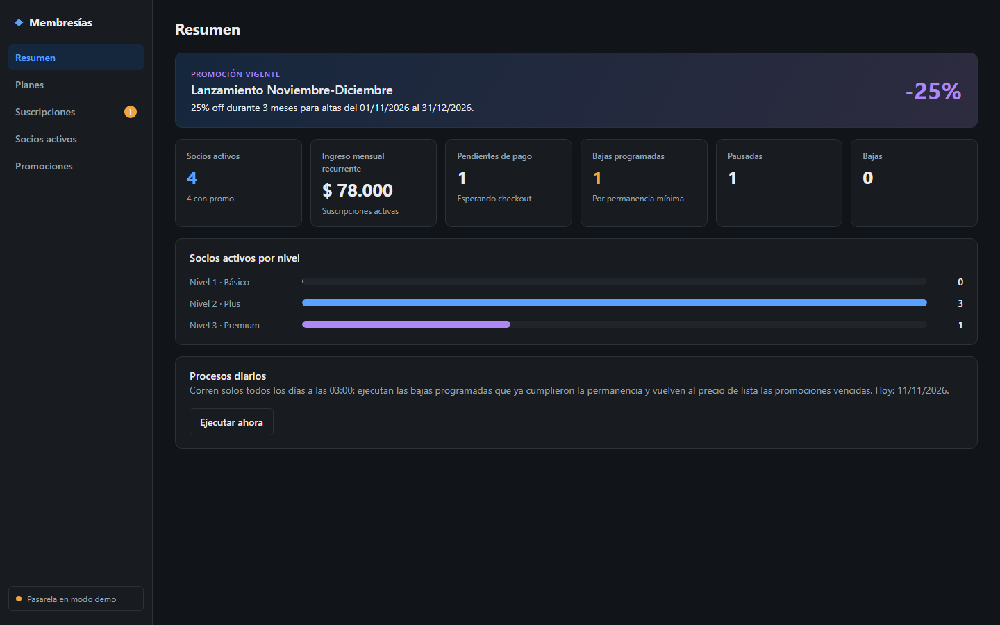

# Membresías con Mercado Pago

Tablero para gestionar planes de membresía y suscriptores, cobrados con **suscripciones de Mercado Pago**
(`preapproval_plan` + `preapproval`).

- **backend/**: Spring Boot 3.5 · Java 21 · Gradle · PostgreSQL (Flyway) · jakarta.*
- **frontend/**: React 19 · Vite · TypeScript



## Requisitos cubiertos

| Requisito | Cómo se resuelve |
|---|---|
| Integración de una pasarela de pagos | `MercadoPagoRestGateway` contra la API de suscripciones de MP; webhook firmado (`x-signature`, HMAC-SHA256) en `/api/webhooks/mercadopago`. Sin credenciales funciona una **pasarela demo** con un simulador de pagos. |
| Gestión de suscripciones desde el dashboard | Alta (genera el link de pago de MP), pausa/reanudación, baja, cambio de nivel y sincronización de estado. |
| Alta, baja y modificación de planes | ABM de planes que se refleja en MP (`POST`/`PUT /preapproval_plan`, la baja lo pasa a `cancelled`), más la **sincronización desde MP** para los planes creados o editados en el panel de MP. |
| Permanencia mínima de 3 meses | Por plan (mínimo 3, configurable hasta 36). Una baja pedida antes de cumplirla queda **programada** para la fecha de fin y la ejecuta el job diario. Se puede deshacer. |
| Beneficios, consumos y horas disponibles | Cada plan tiene beneficios y horas mensuales. Los consumos descuentan horas del período, que se renueva cada mes en la fecha aniversario del alta, y no se puede consumir más de lo disponible. |
| Listado de socios activos | Sección *Socios activos* con buscador, permanencia, horas disponibles y bajas programadas. |
| Escalar a tres niveles de membresía | Niveles Básico / Plus / Premium, con un plan activo por nivel. Upgrade y downgrade actualizan el monto en MP sin reiniciar la permanencia. |
| Promoción de lanzamiento noviembre y diciembre | Promo precargada: **25% off los primeros 3 meses** para altas del 01/11 al 31/12/2026 (editable). Al vencer, el job diario devuelve el precio de lista en MP. |

## Qué se refleja en Mercado Pago

| Acción en el tablero | Llamada a Mercado Pago |
|---|---|
| Crear plan | `POST /preapproval_plan` → guarda `id` e `init_point` (link público del plan) |
| Editar plan | `PUT /preapproval_plan/{id}` (nombre, precio) |
| Dar de baja / reactivar plan | `PUT /preapproval_plan/{id}` `status=cancelled` / se crea de nuevo en MP |
| Sincronizar planes | `GET /preapproval_plan/search?status=active`: importa, actualiza y da de baja según MP |
| Nueva suscripción | `POST /preapproval` (`status=pending`, `external_reference=SUB-{id}`) → link de pago para el socio |
| Pausar / reanudar / baja | `PUT /preapproval/{id}` `status=paused/authorized/cancelled` |
| Cambio de nivel, fin de promo | `PUT /preapproval/{id}` `auto_recurring.transaction_amount` |
| Alta desde el link del plan | Llega por webhook, se crea el socio y, si hay promo, se ajusta el monto en MP |
| Sincronizar estado | `GET /preapproval/{id}` de cada suscripción vigente (también cada 5 min y al arrancar) |

Lo único que vive **solo en el tablero** es lo que MP no modela: nivel, horas, beneficios, consumos y permanencia mínima.

## Cómo correrlo

### Rápido, sin Docker ni credenciales (H2 en memoria + pasarela demo)

```bash
cd backend && ./gradlew bootTestRun        # API en http://localhost:8080
cd frontend && npm install && npm run dev  # tablero en http://localhost:5173
python scripts/seed_demo.py                # datos de ejemplo (opcional)
```

En modo demo, cada suscripción pendiente tiene un botón **Simular pago**.

### Con PostgreSQL

```bash
docker compose up -d                       # PostgreSQL 16 en :5432 (db/usuario/clave: subs)
cd backend && ./gradlew bootRun
```

## Conectar con Mercado Pago (sandbox)

1. **Usuarios de prueba**: en [Tus integraciones](https://www.mercadopago.com.ar/developers/panel/app) → *Cuentas de prueba*,
   creá un usuario **vendedor** y uno **comprador** (país Argentina). Las suscripciones necesitan que pagador y
   cobrador sean ambos de prueba.
2. **Access Token del vendedor de prueba**: iniciá sesión con el vendedor de prueba (en una ventana de incógnito),
   creá una aplicación y copiá su Access Token. Si usás el `TEST-…` de tu cuenta real y MP responde que los usuarios
   no son compatibles, usá el del vendedor de prueba.
3. Copiá `backend/.env.example` a `backend/.env` y completá `MP_ACCESS_TOKEN` (el archivo está en `.gitignore`).
4. Reiniciá el backend. La barra lateral tiene que decir **"Mercado Pago conectado"**. Al arrancar se importan los planes
   que ya tengas en MP.
5. Creá un plan → aparece en MP. Creá una suscripción con el **email del comprador de prueba** → abrí el link y pagá
   logueado como comprador, con una [tarjeta de prueba](https://www.mercadopago.com.ar/developers/es/docs/subscriptions/additional-content/your-integrations/test/cards)
   (titular `APRO` para aprobar).
6. **Estado**: sin URL pública usá *⟳ Sincronizar estado* (también corre cada 5 min). Para recibir los webhooks en vivo:
   `ngrok http 8080 --traffic-policy-file=scripts/ngrok-webhook-policy.yml` (la política deja pasar **solo**
   `POST /api/webhooks/mercadopago`, porque el resto de la API no tiene login) → en *Webhooks* de la aplicación configurá
   `https://<tu-ngrok>/api/webhooks/mercadopago` con el tópico **Planes y suscripciones**, y copiá la clave secreta en
   `MP_WEBHOOK_SECRET`.

`MP_BACK_URL` tiene que ser una URL https pública (MP no acepta `localhost`).

## API

| Método | Ruta | |
|---|---|---|
| GET | `/api/dashboard/summary` | KPIs, socios por nivel, promo vigente, modo de pasarela |
| GET/POST | `/api/plans` | listar (`?activeOnly=true`) / crear |
| GET/PUT/DELETE | `/api/plans/{id}` | ver / modificar / baja lógica |
| POST | `/api/plans/{id}/activate` · `/api/plans/sync` | reactivar · sincronizar con MP |
| GET/POST | `/api/subscriptions` | listar (`?status=ACTIVE`) / alta con link de pago |
| POST | `/api/subscriptions/{id}/pause` · `/resume` · `/cancel` | gestión |
| DELETE | `/api/subscriptions/{id}/cancel` | deshacer baja programada |
| PUT | `/api/subscriptions/{id}/plan` | upgrade / downgrade |
| GET/POST | `/api/subscriptions/{id}/consumptions` | horas del período y consumos |
| POST | `/api/subscriptions/sync` | traer estado desde MP |
| GET | `/api/members/active` | socios activos |
| GET/POST/PUT | `/api/promotions` | promociones |
| POST | `/api/admin/jobs/run` | ejecutar ahora bajas programadas y fin de promos |
| POST | `/api/webhooks/mercadopago` | notificaciones de MP |
| POST | `/api/demo/subscriptions/{id}/simulate` | solo modo demo |

## Tests

```bash
cd backend && ./gradlew test     # 79 tests: dominio, adaptador MP (MockRestServiceServer), API, webhook
cd frontend && npm test          # 15 tests: formatos y acciones por estado
```

Las reglas de negocio son funciones puras en `backend/src/main/java/com/testsusmp/subs/domain/`
(`PermanencePolicy`, `PricingCalculator`, `HoursCalculator`, `TierPolicy`).

## Notas y límites

- Las suscripciones del tablero se crean como `preapproval` **sin plan asociado**: MP exige `card_token_id` para
  asociarlas a un plan, y así se puede aplicar la promo y usar `external_reference`. Las altas hechas desde el link
  público del plan sí quedan asociadas al plan en MP y se importan por webhook o sincronización.
- El dashboard no tiene login: pensado para uso interno. Antes de exponerlo, agregar autenticación.
- Las horas no acumulan entre períodos.
